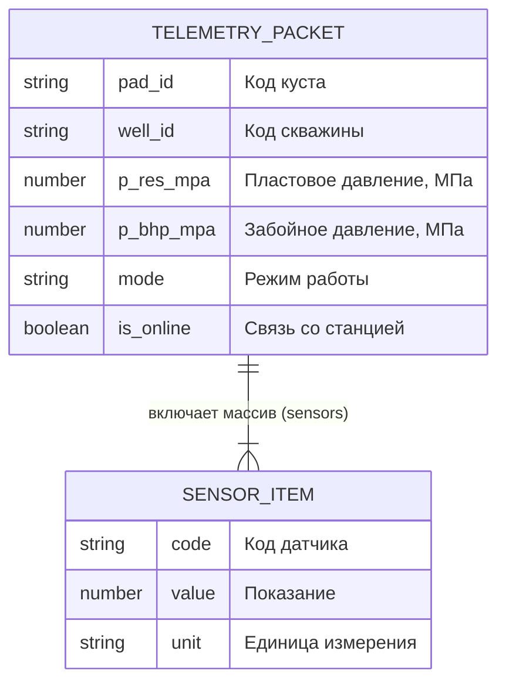

# Практическая работа №2. Проектирование структур данных: JSON и JSON-Schema (Вариант Б)

## Титульный блок

- Студент: **Доскарин Дамир Талгатович**
- Работа выполнена одним студентом за пару: он последовательно выполнил обе роли.
  - Этап 1 (Пара 1): Системный аналитик (README.md, Data Dictionary, ER-диаграмма) и Разработчик (`entity_model.py`).
  - Этап 2 (Пара 2): Системный аналитик (`schema.json`) и Разработчик (`validator.py`).
- Расчёт: **N = 10** (N = N1 + N2 = 10)
- Репозиторий GitHub: https://github.com/KXNVRA887/pract2

### Индивидуальные числа (Вариант Б)

| Параметр | Формула | Значение |
|---|---|---|
| pad_id | "PAD-" + (10 + N % 20) | **PAD-20** |
| well_id | "W-" + (200 + N) | **W-210** |
| p_res_mpa | 22.0 + 0.5 * (N % 20) | **27.0** МПа |
| p_bhp_mpa | 12.0 + 0.4 * (N % 20) | **16.0** МПа |
| temp_c | 45.0 + 1.5 * (N % 15) | **60.0** °C |
| rate_m3d | 60.0 + 4.0 * (N % 25) | **100.0** м³/сут |

---

# Этап 1. Модель сущностей и файловый обмен JSON

## Таблица полей (Data Dictionary)

| Поле (путь JSON) | Описание смысла поля | Тип Python | Тип JSON | Обяз.? | Ваше значение |
|---|---|---|---|---|---|
| pad_id | Номер кустовой площадки | str | string | Да | "PAD-20" |
| well_id | Код скважины | str | string | Да | "W-210" |
| p_res_mpa | Пластовое давление, МПа | float | number | Да | 27.0 |
| p_bhp_mpa | Забойное давление, МПа | float | number | Да | 16.0 |
| mode | Режим эксплуатации скважины | str | string | Да | "PUMPING" |
| is_online | Признак связи со станцией (Челлендж 1) | bool | boolean | Да | True (в JSON: true) |
| sensors | Список замеров с датчиков | list[dict] | array | Да | [{...}, {...}, {...}] |
| sensors[].code | Код датчика в массиве | str | string | Да | "T-01", "Q-01", "P-01" |
| sensors[].value | Измеренное показание датчика | float | number | Да | 60.0, 100.0, 14.0 |
| sensors[].unit | Единица измерения датчика | str | string | Да | "C", "m3/d", "MPa" |

## ER-диаграмма



Символ `||--|{` («воронья лапка») означает, что внутри пакета лежит список словарей `list[dict]` (связь 1 ко многим).

## Содержимое data.json

```json
{
    "pad_id": "PAD-20",
    "well_id": "W-210",
    "p_res_mpa": 27.0,
    "p_bhp_mpa": 16.0,
    "mode": "PUMPING",
    "is_online": true,
    "sensors": [
        {
            "code": "T-01",
            "value": 60.0,
            "unit": "C"
        },
        {
            "code": "Q-01",
            "value": 100.0,
            "unit": "m3/d"
        },
        {
            "code": "P-01",
            "value": 14.0,
            "unit": "MPa"
        }
    ]
}
```

## Наблюдения (data.json и словарь Python)

- В JSON все ключи и строки в двойных кавычках.
- `True` из Python записано как `true`.
- Кириллица (если бы она была в данных) сохраняется благодаря `ensure_ascii=False`.
- Список словарей `sensors` стал JSON-массивом `[{...}, {...}, {...}]`.

## Челлендж №1: «Новое требование к модели данных»

В корень пакета добавлено булево поле `is_online` (True) и третий датчик устьевого давления `{"code": "P-01", "value": 14.0, "unit": "MPa"}`. Изменения внесены в таблицу полей и ER-диаграмму этого README и в `entity_model.py`; после перезапуска `data.json` обновился.

### Вывод запуска `python entity_model.py`

```text
[OK] Файл 'data.json' успешно записан на диск!
[OK] Обратное чтение через json.load() прошло успешно!

==========================================================
ПАКЕТ ТЕЛЕМЕТРИИ: Куст PAD-20 | Скважина W-210
==========================================================
Режим работы:      PUMPING
Связь со станцией: есть
Давления:          Рпл = 27.0 МПа, Рзаб = 16.0 МПа (dP = 11.00 МПа)
Опрошено датчиков: 3 шт.
  -> Датчик T-01: 60.0 C
  -> Датчик Q-01: 100.0 m3/d
  -> Датчик P-01: 14.0 MPa
==========================================================
```

---

# Этап 2. Контракт данных JSON-Schema и валидатор

Контракт хранится в файле `schema.json` (учтено поле `is_online` из Челленджа 1). Валидатор `validator.py` читает правила из схемы (границы давлений, `enum` режимов и единиц, `minItems` датчиков) и применяет их к `data.json`; дополнительно проверяется физическое правило: при режиме PUMPING забойное давление не может превышать пластовое.

## Таблица сверки тестов валидации

| Тестовый сценарий (Этап 2) | Ожидание по schema.json | Фактический ответ validator.py | Совпало? |
|---|---|---|---|
| Сценарий 1: Эталонный файл data.json | VALID (0 ошибок) | VALID (0 ошибок) | Да |
| Сценарий 2: Нарушение enum режима и единицы датчика | ОТКЛОНЕНО (2 ошибки) | ОТКЛОНЕНО (2): Режим mode='OVERDRIVE' не входит в enum ['FLOWING', 'PUMPING', 'SHUT_IN']; Датчик #0: единица 'psi' не входит в enum ['MPa', 'C', 'm3/d'] | Да |
| Сценарий 3: Только 1 датчик (minItems: 2) | ОТКЛОНЕНО (1 ошибка) | ОТКЛОНЕНО (1): Массив 'sensors' должен содержать минимум 2 датчика | Да |
| Сценарий 4: Рзаб > Рпл при PUMPING | ОТКЛОНЕНО (1 ошибка) | ОТКЛОНЕНО (1): Физическое противоречие: при режиме PUMPING Рзаб > Рпл! | Да |
| Сценарий 5 (Челлендж 2): «Диверсия напарника» | ОТКЛОНЕНО | ОТКЛОНЕНО (2): Давление p_res_mpa=75.0 вне границ схемы [5.0; 60.0]; В датчике #0 отсутствует поле 'value' | Да |

## Челлендж №2: «Слепая проверка: найди диверсию в JSON»

Файл `broken_data.json` - копия `data.json` с двумя скрытыми нарушениями контракта (пластовое давление 75.0 МПа вне границ и удалённое поле `value` у первого датчика). Валидатор вызывается на нём как Сценарий 5 и по выводу находит обе «диверсии».

### Вывод запуска `python validator.py`

```text
==================================================================
ЗАПУСК ПРОВЕРКИ КОНТРАКТА ДАННЫХ ПО ФАЙЛУ schema.json (Вариант Б)
==================================================================

[Сценарий 1] Эталонный файл data.json -> УСПЕШНО (VALID)

[Сценарий 2] Нарушение списков enum -> ОТКЛОНЕНО
  x Режим mode='OVERDRIVE' не входит в enum ['FLOWING', 'PUMPING', 'SHUT_IN']
  x Датчик #0: единица 'psi' не входит в enum ['MPa', 'C', 'm3/d']

[Сценарий 3] Только 1 датчик в массиве sensors -> ОТКЛОНЕНО
  x Массив 'sensors' должен содержать минимум 2 датчика

[Сценарий 4] Противоречие давлений (Рзаб > Рпл) -> ОТКЛОНЕНО
  x Физическое противоречие: при режиме PUMPING Рзаб > Рпл!

[Сценарий 5] Файл broken_data.json -> ОТКЛОНЕНО
  x Давление p_res_mpa=75.0 вне границ схемы [5.0; 60.0]
  x В датчике #0 отсутствует поле 'value'
```

---

# Ответы на контрольные вопросы

**Вопрос 1.1.** Единый словарь (пакет) передаётся как один объект: не нужно помнить порядок многих аргументов, легко добавить поле, сохраняется вложенность (список датчиков), а весь объект сразу сериализуется в JSON.

**Вопрос 1.2.** Отличия JSON от dict: 1) только двойные кавычки; 2) `true`/`false`/`null` вместо `True`/`False`/`None`; 3) нельзя запятую после последнего элемента и комментарии; 4) JSON - текст, dict - объект в памяти. `ensure_ascii=False` нужен, чтобы кириллица записывалась читаемо, а не кодами `\uXXXX`.

**Вопрос 2.1.** Контракт данных - договорённость о полях, типах и границах. `required` - список обязательных полей; `properties` - описание каждого поля; `minimum`/`maximum` - границы числа; `enum` - закрытый список допустимых значений.

**Вопрос 2.2.** В Python `bool` - подкласс `int` (`isinstance(True, int)` даёт `True`), поэтому там, где нужно именно число, булево значение надо отдельно отсекать проверкой `not isinstance(x, bool)`.
